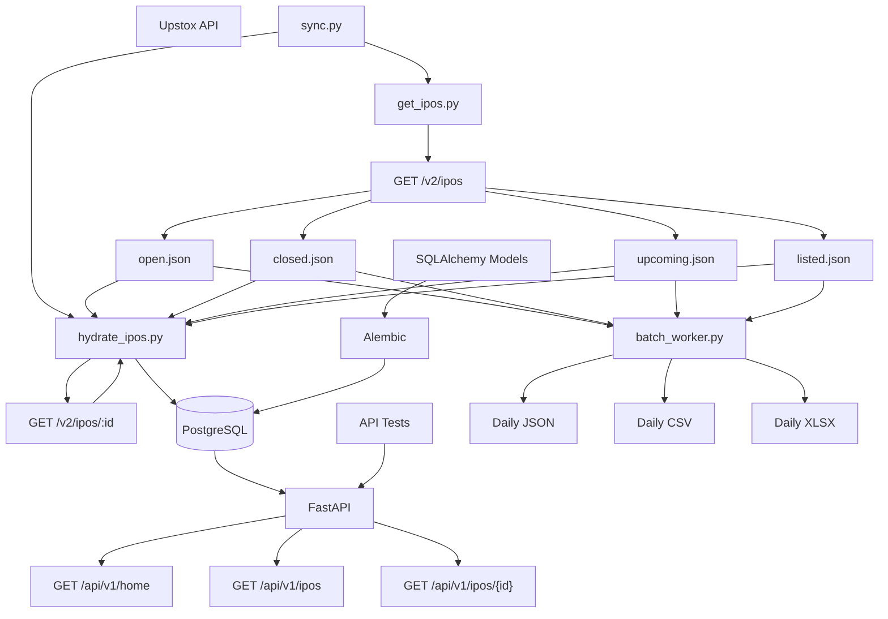
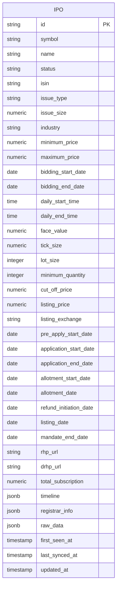
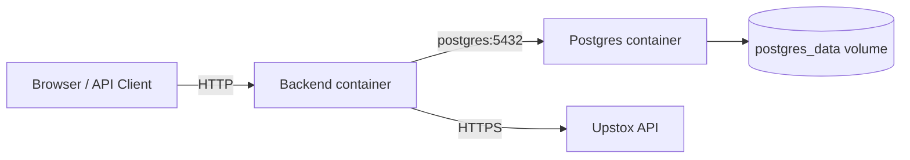
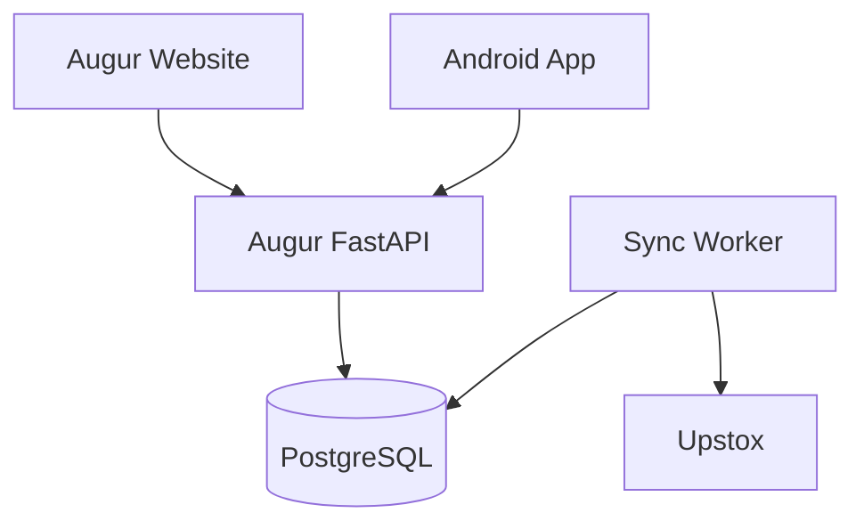
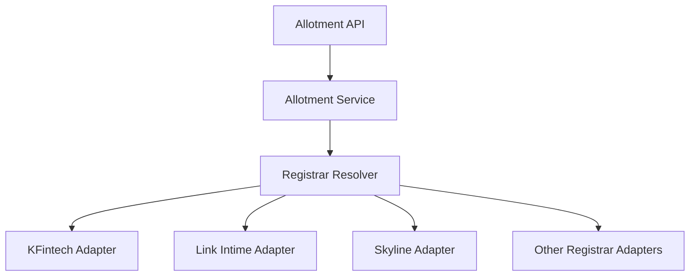

# Augur Backend

Augur is an IPO data backend focused on collecting IPO information from Upstox, normalizing and storing it in PostgreSQL, and exposing a stable API for the future Augur website and Android application.

The current release is focused on the **IPO data foundation and API v1**. Allotment checking, DRHP/RHP document processing, RAG-based IPO insights, authentication, and other user-facing features are intentionally deferred to later versions.

---

## Current Status

### Data and database

- [x] Upstox IPO list ingestion through `/v2/ipos`
- [x] Support for both `regular` and `sme` IPOs
- [x] Status-based JSON staging:
  - `open.json`
  - `closed.json`
  - `upcoming.json`
  - `listed.json`
- [x] Full IPO hydration through `/v2/ipos/:id`
- [x] PostgreSQL database
- [x] SQLAlchemy ORM
- [x] Alembic migrations
- [x] UPSERT-based IPO persistence
- [x] Raw Upstox payload preservation through JSONB
- [x] Day-end JSON/CSV/XLSX export
- [x] Database query indexes
- [x] Shared Upstox client (rate limiting + retry with backoff)
- [x] Targeted retry of previously-failed IPOs

### API v1

- [x] FastAPI application
- [x] `GET /health`
- [x] `GET /ready`
- [x] `GET /health/upstox`
- [x] `GET /api/v1/home`
- [x] `GET /api/v1/ipos`
- [x] `GET /api/v1/ipos/{ipo_id}`
- [x] Status filtering
- [x] Regular/SME filtering
- [x] Pagination
- [x] Sorting
- [x] Missing/optional field handling
- [x] CORS configuration
- [x] Common error response format
- [x] API and PostgreSQL integration tests

### Reproducibility

- [x] Dockerfile
- [x] Docker Compose
- [x] Separate native and Docker database configuration
- [x] Environment variable configuration
- [x] End-to-end Docker sync

### Deferred

- [ ] Allotment checker
- [ ] Registrar abstraction/adapters
- [ ] DRHP/RHP document ingestion
- [ ] RAG / IPO intelligence
- [ ] User authentication
- [ ] Watchlists and notifications
- [ ] Android app
- [ ] Production deployment / CI/CD
- [ ] Additional lifecycle states such as `allotted`

---

# Architecture

The system separates **discovery**, **hydration**, **storage**, and **API serving**.



## Why the pipeline is split this way

- `/v2/ipos` is the **discovery endpoint**.
  - It identifies IPOs by lifecycle status and issue type.
  - The result is written to four JSON staging files.
- `/v2/ipos/:id` is the **hydration endpoint**.
  - It provides detailed IPO information.
  - The response is normalized and persisted in PostgreSQL.
- PostgreSQL is the **application source of truth**.
  - The JSON files are staging/snapshot artifacts, not the permanent data store.
- FastAPI exposes only the public contract required by Augur.
  - Clients do not access PostgreSQL or Upstox directly.
- The day-end batch worker produces JSON, CSV, and XLSX exports from the staging files without modifying PostgreSQL.

This separation gives the project a clear debugging path: discovery, hydration, normalization, persistence, and API serving can each be checked independently.

---

# Project Structure

```text
backend/
├── app/
│   ├── __init__.py
│   ├── database.py
│   ├── exceptions.py
│   ├── models.py
│   ├── main.py
│   ├── api/
│   │   ├── __init__.py
│   │   ├── dependencies.py
│   │   ├── exception_handlers.py
│   │   └── routes/
│   │       ├── __init__.py
│   │       ├── health.py
│   │       ├── home.py
│   │       └── ipos.py
│   ├── integrations/
│   │   └── upstox.py
│   ├── repositories/
│   │   ├── home.py
│   │   └── ipo.py
│   ├── schemas/
│   │   ├── errors.py
│   │   ├── home.py
│   │   └── ipo.py
│   └── services/
│       ├── home.py
│       └── ipo.py
│
├── tests/
│   ├── __init__.py
│   ├── conftest.py
│   ├── test_health.py
│   ├── test_home.py
│   └── test_ipos.py
│
├── ipos/
│   ├── open.json
│   ├── closed.json
│   ├── upcoming.json
│   └── listed.json
│
├── migrations/
│   ├── env.py
│   ├── script.py.mako
│   └── versions/
│
├── exports/
│   └── daily/
│       └── YYYY-MM-DD/
│           ├── ipos.json
│           ├── ipos.csv
│           └── ipos.xlsx
│
├── .dockerignore
├── .env
├── .env.docker
├── .env.example
├── alembic.ini
├── batch_worker.py
├── docker-compose.yml
├── Dockerfile
├── get_ipos.py
├── hydrate_ipos.py
├── requirements.txt
├── requirements-dev.txt
├── pytest.ini
├── setup.sh
└── sync.py
```

## Important files

- `app/database.py`
  - SQLAlchemy engine and session configuration.
  - Reads PostgreSQL configuration from environment variables.
- `app/models.py`
  - Defines the PostgreSQL schema.
  - Defines database constraints and query indexes.
- `app/main.py`
  - Creates the FastAPI application.
  - Registers CORS, exception handlers, and routers.
- `app/api/routes/health.py`
  - Provides `/health` and `/ready`.
- `app/api/routes/home.py`
  - Provides the homepage preview endpoint.
- `app/api/routes/ipos.py`
  - Provides the public IPO list and detail endpoints.
- `app/services/`
  - Contains application/business logic and API serialization.
- `app/repositories/`
  - Contains database query logic.
- `app/schemas/`
  - Defines public API response contracts.
- `app/exceptions.py`
  - Defines application-level errors.
- `app/api/exception_handlers.py`
  - Converts application, validation, database, and unexpected errors into the common API error format.
- `get_ipos.py`
  - Calls Upstox `/v2/ipos`.
  - Handles status + issue-type combinations.
  - Handles pagination.
  - Writes the four JSON staging files.
- `hydrate_ipos.py`
  - Reads the four JSON files.
  - Collects unique IPO IDs.
  - Calls `/ipos/:id` (concurrent, 10 at a time, chunked commits of 20).
  - Normalizes the detailed response.
  - UPSERTs into PostgreSQL.
  - Writes `hydration_failures.json` on failure.
- `app/integrations/upstox.py`
  - Shared Upstox client: base URL, auth headers, timeouts, retries, rate limiter.
  - Sync (`with_retry`) and async (`with_retry_async`) retry helpers.
  - Rate limiter (`REQUEST_RATE = 10/s`) paces requests so Upstox never sees a burst.
  - `is_reachable()` used by `GET /health/upstox` for fast deploy-time token validation.
- `sync.py`
  - Runs discovery first.
  - Runs hydration only after discovery succeeds.
- `batch_worker.py`
  - Produces day-end JSON, CSV, and Excel exports.
- `migrations/`
  - Contains version-controlled Alembic migrations.
- `Dockerfile`
  - Builds the Python application image.
- `docker-compose.yml`
  - Runs the backend and PostgreSQL together.
- `setup.sh`
  - Intended to bootstrap the environment on a fresh machine.

---

# Database Design

The current PostgreSQL design intentionally keeps the IPO model simple.

There is one primary `ipos` table for both regular and SME IPOs.



## Regular vs SME

Regular and SME IPOs are **not separate tables**.

They are represented by:

```text
issue_type = regular
issue_type = sme
```

## Lifecycle status

The current API/database lifecycle states are:

```text
upcoming
open
closed
listed
```

No additional `allotted` state is included in the current version.

Examples:

```sql
SELECT *
FROM ipos
WHERE status = 'open';
```

```sql
SELECT *
FROM ipos
WHERE issue_type = 'sme';
```

```sql
SELECT *
FROM ipos
WHERE status = 'open'
  AND issue_type = 'sme';
```

## Dates

Frequently queried dates such as:

- `bidding_start_date`
- `bidding_end_date`
- `allotment_date`
- `listing_date`

are stored as PostgreSQL columns so they can be sorted and filtered efficiently.

The complete nested `timeline` object is also preserved as JSONB.

The same principle applies to `registrar_info` and `raw_data`.

---

# Database Indexes

Indexes are defined in `app/models.py` and materialized through Alembic migrations.

Current query indexes are designed around the API's real filters and sorting patterns:

```text
(status, issue_type)
(status, first_seen_at)
(status, bidding_start_date)
(status, bidding_end_date)
(status, listing_date)
issue_type
```

These support queries such as:

```text
/api/v1/ipos?status=open&issue_type=sme
/api/v1/ipos?status=upcoming&sort=bidding_start_date
/api/v1/ipos?status=open&sort=bidding_end_date
/api/v1/ipos?status=listed&sort=listing_date
```

Indexes are an internal PostgreSQL optimization. They do not change the logical IPO records stored in the table.

---

# API v1

The public API is served by FastAPI.

## Endpoints

```text
GET /health
GET /ready
GET /health/upstox

GET /api/v1/home

GET /api/v1/ipos
GET /api/v1/ipos/{ipo_id}
```

## Upstox rate limiting and retries

All Upstox traffic is centralized in `app/integrations/upstox.py`, so discovery and hydration cannot drift apart.

- Requests are **paced** (`REQUEST_RATE = 10/s`) so Upstox never sees a burst worth throttling.
- Transient failures (`429`, `5xx`, transport errors) are **retried with exponential backoff** and jitter.
- A `Retry-After` header, when present, is honored over the computed backoff.
- Hydration uses an **async** retry path (`with_retry_async`) that awaits inside the retry loop; the sync path (`with_retry`) is used by discovery.
- `GET /health/upstox` fails fast (5s, no retries) so a stale token is caught at deploy time.

## Sync and retry

```bash
python sync.py              # discovery → hydration → PostgreSQL
python sync.py --only open  # hydrate one lifecycle slice, no re-discovery
python sync.py --retry-failed
python hydrate_ipos.py --retry-failed
```

`--retry-failed` reads `hydration_failures.json` and retries only the IPOs that failed the previous run. The sidecar is **always rewritten** on a retry run, so previously-succeeded IDs don't linger in the file forever.

## Health

`GET /health`

Basic process-level health check.

Example:

```json
{
  "status": "ok"
}
```

## Readiness

`GET /ready`

Checks whether required dependencies, including PostgreSQL, are reachable.

Example:

```json
{
  "status": "ready",
  "database": "ok"
}
```

## Upstox reachability

`GET /health/upstox`

Checks that the Upstox API is reachable with the configured access token. A stale or missing token fails here instead of during a sync, so the failure is visible at deploy time.

Example:

```json
{
  "status": "ok",
  "upstox": "ok"
}
```

## Homepage

`GET /api/v1/home`

Returns a small preview for the public homepage, grouped into the four current lifecycle states:

```json
{
  "upcoming": [],
  "open": [],
  "closed": [],
  "listed": []
}
```

The homepage is intentionally a preview endpoint. The frontend can show a `Show All` action for each section and use the paginated `/api/v1/ipos` endpoint for the full list.

## IPO list

`GET /api/v1/ipos`

Supported query parameters:

```text
status=upcoming|open|closed|listed
issue_type=regular|sme
sort=newest|listing_date|bidding_start_date|bidding_end_date
page=1
limit=20
from_date=YYYY-MM-DD
to_date=YYYY-MM-DD
```

Examples:

```text
/api/v1/ipos?status=open
/api/v1/ipos?issue_type=sme
/api/v1/ipos?status=open&issue_type=sme
/api/v1/ipos?page=1&limit=20
/api/v1/ipos?status=listed&sort=listing_date
/api/v1/ipos?from_date=2026-09-01&to_date=2026-09-30
```

The response is paginated:

```json
{
  "data": [],
  "pagination": {
    "page": 1,
    "limit": 20,
    "total": 0,
    "pages": 0
  }
}
```

## IPO detail

`GET /api/v1/ipos/{ipo_id}`

Returns the stored detailed IPO record, including fields such as:

- pricing
- bidding dates/times
- lot size
- listing information
- document URLs
- timeline
- registrar information

Fields whose values are unavailable are omitted from the response rather than returned as JSON `null`.

This keeps the API contract clean while allowing the frontend to display its own missing-value representation such as `-`.

---

# API Error Contract

Expected API errors use one consistent structure:

```json
{
  "error": {
    "code": "IPO_NOT_FOUND",
    "message": "IPO not found",
    "details": null
  }
}
```

Current error categories include:

| HTTP status | Error code | Meaning |
|---|---|---|
| `404` | `IPO_NOT_FOUND` | Requested IPO does not exist |
| `422` | `VALIDATION_ERROR` | Request validation failed |
| `503` | `DATABASE_NOT_READY` | Readiness dependency is unavailable |
| `503` | `DATABASE_UNAVAILABLE` | Database could not serve the request |
| `500` | `INTERNAL_SERVER_ERROR` | Unexpected server error |

Validation details are returned under `error.details`.

---

# CORS

CORS origins are configured through the environment.

Development values:

```env
CORS_ORIGINS=http://localhost:3000,http://localhost:5173
```

This allows a future Next.js/Vite website to call the API from the browser.

Production origins should be changed to the actual frontend domains rather than using a wildcard.

---

# Environment Variables

## Native development

Native development uses `.env`.

```env
APP_ENV=development

DB_HOST=localhost
DB_PORT=5432
DB_NAME=augur_project
DB_USER=ipo_user
DB_PASSWORD=your_password

UPSTOX_ACCESS_TOKEN=your_upstox_access_token

CORS_ORIGINS=http://localhost:3000,http://localhost:5173
```

## Docker development

Docker uses `.env.docker`.

```env
APP_ENV=development

DB_HOST=postgres
DB_PORT=5432
DB_NAME=augur_project
DB_USER=ipo_user
DB_PASSWORD=your_password

UPSTOX_ACCESS_TOKEN=your_upstox_access_token

CORS_ORIGINS=http://localhost:3000,http://localhost:5173
```

The important difference is:

```text
Native PostgreSQL:
DB_HOST=localhost

Docker PostgreSQL:
DB_HOST=postgres
```

`postgres` is the PostgreSQL service name in `docker-compose.yml`.

## Security

Never commit:

```text
.env
.env.docker
```

Commit:

```text
.env.example
```

with safe placeholders only.

---

# Native Setup

Use this when Python and PostgreSQL are installed directly on the machine.

## Prerequisites

- Python 3.13+
- PostgreSQL 17 or a compatible supported version
- Git
- A valid Upstox access token

## 1. Clone

```bash
git clone <repository-url>
cd augur/backend
```

## 2. Create a virtual environment

```bash
python3 -m venv .venv
source .venv/bin/activate
```

## 3. Install dependencies

```bash
pip install -r requirements.txt
```

For API tests:

```bash
pip install -r requirements-dev.txt
```

## 4. Configure environment

```bash
cp .env.example .env
```

Edit `.env` and provide PostgreSQL credentials and the Upstox access token.

## 5. Create the PostgreSQL database

Example:

```sql
CREATE USER ipo_user WITH PASSWORD 'your_password';
CREATE DATABASE augur_project OWNER ipo_user;
```

## 6. Apply migrations

```bash
alembic upgrade head
```

## 7. Run the complete IPO sync

```bash
python sync.py
```

This runs:

```text
get_ipos.py
    ↓
JSON staging files
    ↓
hydrate_ipos.py
    ↓
PostgreSQL
```

## 8. Start the API

From `backend/`:

```bash
uvicorn app.main:app --host 0.0.0.0 --port 8000
```

API documentation:

```text
http://127.0.0.1:8000/docs
```

## 9. Run tests

```bash
RUN_INTEGRATION_TESTS=1 pytest -q
```

## 10. Generate day-end exports

```bash
python batch_worker.py
```

Output:

```text
exports/daily/YYYY-MM-DD/
├── ipos.json
├── ipos.csv
└── ipos.xlsx
```

The workbook contains:

- `All IPOs`
- `Open`
- `Upcoming`
- `Closed`
- `Listed`

---

# Docker Setup

Docker is the preferred reproducible environment for team development.

## 1. Prerequisites

- Docker
- Docker Compose
- Git

PostgreSQL does not need to be installed on the host for the Docker workflow.

## 2. Clone

```bash
git clone <repository-url>
cd augur/backend
```

## 3. Configure Docker credentials

```bash
cp .env.example .env.docker
```

Edit `.env.docker`:

```env
APP_ENV=development

DB_HOST=postgres
DB_PORT=5432
DB_NAME=augur_project
DB_USER=ipo_user
DB_PASSWORD=your_password

UPSTOX_ACCESS_TOKEN=your_upstox_access_token

CORS_ORIGINS=http://localhost:3000,http://localhost:5173
```

## 4. Build and start containers

```bash
docker compose up -d
```

Check:

```bash
docker compose ps
```

The PostgreSQL service should report `healthy`.

## 5. Apply migrations

```bash
docker compose exec backend alembic upgrade head
```

## 6. Run synchronization

```bash
docker compose exec backend python sync.py
```

## 7. Start API

The Compose configuration exposes:

```text
http://127.0.0.1:8000
```

## 8. Generate exports

```bash
docker compose exec backend python batch_worker.py
```

## Docker architecture



The native PostgreSQL instance and Docker PostgreSQL are separate databases.

With the current Compose setup:

```text
Host:
localhost:5433

Docker network:
postgres:5432
```

---

# Data Flow

## Discovery

`get_ipos.py` queries the Upstox list endpoint for:

```text
upcoming + regular
upcoming + sme
open + regular
open + sme
closed + regular
closed + sme
listed + regular
listed + sme
```

It handles pagination and writes the four status files.

Requests are paced at `REQUEST_RATE = 10/s` and transient failures are retried with exponential backoff and jitter.

## Hydration

`hydrate_ipos.py` reads all four JSON files, creates a unique set of IPO IDs, then calls:

```text
GET /v2/ipos/{id}
```

Concurrency is bounded (10), commits are chunked (20). The full response is normalized and inserted with PostgreSQL UPSERT semantics.

Repeated hydration does not create duplicate IPO rows.

Failures are written to `hydration_failures.json`. Retry with:

```bash
python sync.py --retry-failed
python hydrate_ipos.py --retry-failed
```

The sidecar is always rewritten on a retry run so previously-succeeded IDs don't linger.

## Persistence

PostgreSQL contains:

- structured columns for commonly queried IPO fields
- JSONB for `timeline`
- JSONB for `registrar_info`
- JSONB for the complete `raw_data`

This keeps the database queryable while preserving the upstream payload.

## API

The API reads from PostgreSQL.

```text
Web / Android
      ↓
FastAPI
      ↓
PostgreSQL
```

Clients do not call Upstox directly.

## Day-end export

`batch_worker.py` reads the four JSON files and creates:

```text
ipos.json
ipos.csv
ipos.xlsx
```

It does not fetch Upstox data itself.

---

# Why the JSON Layer Exists

The JSON files are a deliberate checkpoint between two independent operations:

```text
Upstox /ipos
     ↓
JSON files
     ↓
/ipos/:id
     ↓
PostgreSQL
```

This gives us:

- easier debugging
- a clear audit point
- retryable hydration
- a snapshot of the list endpoint
- simpler inspection of regular vs SME and status changes

They are staging/snapshot artifacts. PostgreSQL remains the application source of truth.

---

# Development Principles

- Keep external API calls inside integration code.
- Keep database access separate from route handlers.
- Keep PostgreSQL as the application source of truth.
- Keep Alembic migrations under version control.
- Keep the public API contract separate from the SQLAlchemy model.
- Keep repeated synchronization idempotent.
- Preserve raw upstream data where practical.
- Keep API responses stable and frontend-independent.
- Use indexes only for real filtering/sorting patterns.
- Do not add Redis, Kafka, Celery, or other infrastructure until a real workload justifies it.
- Treat external APIs as unreliable dependencies: use timeouts, retries, validation, and controlled concurrency where appropriate.
- Keep future allotment and document/RAG functionality isolated from the current v1 data/API layer.

---

# Testing

The project uses `pytest` for API and integration tests.

Current coverage includes:

- `/health`
- `/ready`
- `/api/v1/home`
- IPO list endpoint
- IPO detail endpoint
- filtering
- pagination
- sorting
- invalid parameters
- unknown IPO / `404`
- optional/missing IPO fields
- common error responses
- PostgreSQL integration checks

Run the standard test suite:

```bash
pytest -q
```

Run with database integration checks:

```bash
RUN_INTEGRATION_TESTS=1 pytest -q
```

---

# Current v1 Roadmap

```text
Phase 1 — Data Foundation                         DONE
├── Upstox /ipos ingestion
├── JSON staging
├── /ipos/:id hydration
├── PostgreSQL
├── SQLAlchemy
└── Alembic

Phase 2 — Reproducible Environment                DONE
├── Dockerfile
├── Docker Compose
├── Environment separation
└── End-to-end Docker sync

Phase 3 — API v1                                 DONE
├── FastAPI
├── /health
├── /ready
├── /api/v1/home
├── /api/v1/ipos
├── /api/v1/ipos/{id}
├── Filtering
├── Sorting
├── Pagination
├── Indexes
├── CORS
├── Common errors
└── Automated tests

Phase 4 — Web Application                         NEXT
├── Homepage
├── Upcoming / Open / Closed / Listed sections
├── IPO listing pages
├── IPO detail page
└── API integration

Phase 5 — Android Application                     PLANNED
├── Reuse the same API
├── IPO discovery
├── IPO details
└── Native mobile UI

Later Versions
├── Allotment checker
├── Registrar abstraction and adapters
├── Additional lifecycle states such as allotted
├── DRHP/RHP document ingestion
├── RAG / IPO intelligence
├── Authentication
├── Watchlists
├── Notifications
├── CI/CD
└── Production deployment
```

---

# Future Website / Mobile Architecture

The intended client architecture is:



For the website:

```text
https://augur.com/
        ↓
Web frontend
        ↓
https://api.augur.com/api/v1/home
```

The website root is the frontend, not a redirect to the API. The frontend requests homepage data from the versioned FastAPI API.

---

# Future Features

The following are intentionally outside the current v1 scope.

## Allotment checker

Future architecture:



Registrar-specific concerns will include:

- request format
- application number rules
- PAN handling
- captcha behavior
- response structure
- rate limits
- downtime
- anti-automation behavior

This subsystem will be isolated from the core IPO API.

## DRHP/RHP documents and RAG

Future pipeline:

```text
IPO
 ↓
DRHP / RHP
 ↓
PDF ingestion
 ↓
Page-aware text extraction
 ↓
Chunking
 ↓
Embeddings / vector storage
 ↓
RAG
 ↓
IPO insights
```

Potential future API:

```text
GET /api/v1/ipos/{ipo_id}/documents
GET /api/v1/ipos/{ipo_id}/insights
```

This is deliberately deferred to a later version.

---

# Useful Commands

## Native

Activate environment:

```bash
source .venv/bin/activate
```

Run migrations:

```bash
alembic upgrade head
```

Run full synchronization:

```bash
python sync.py
```

Hydrate only a specific lifecycle status (no re-discovery):

```bash
python sync.py --only open
python hydrate_ipos.py --only open
```

Retry only the IPOs that failed in the previous run:

```bash
python sync.py --retry-failed
python hydrate_ipos.py --retry-failed
```

Start API:

```bash
uvicorn app.main:app --host 0.0.0.0 --port 8000
```

Run tests:

```bash
RUN_INTEGRATION_TESTS=1 pytest -q
```

Generate day-end exports:

```bash
python batch_worker.py
```

Create a new migration after changing models:

```bash
alembic revision --autogenerate -m "describe change"
```

## Docker

Start services:

```bash
docker compose up -d
```

Check services:

```bash
docker compose ps
```

Apply migrations:

```bash
docker compose exec backend alembic upgrade head
```

Run synchronization:

```bash
docker compose exec backend python sync.py
```

Generate exports:

```bash
docker compose exec backend python batch_worker.py
```

Open a shell:

```bash
docker compose exec backend bash
```

Connect to Docker PostgreSQL from the host:

```bash
psql -U ipo_user -h localhost -p 5433 -d augur_project -W
```

---

# Guiding Idea

The system should remain easy to reason about as it grows.

When a client asks for IPO data:

```text
API → PostgreSQL
```

When fresh IPO data is required:

```text
Sync → Upstox → JSON staging → PostgreSQL
```

When the website needs homepage data:

```text
Website → /api/v1/home → PostgreSQL
```

When the website needs a full filtered list:

```text
Website → /api/v1/ipos → PostgreSQL
```

When an allotment result is eventually required:

```text
API → Allotment Service → Registrar
```

When document intelligence is eventually required:

```text
API → Document / RAG subsystem
```

Each path has one clear responsibility. The goal is to keep the v1 backend stable while later features are added as independent subsystems.
