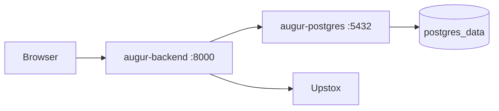

# Architecture

Augur is a small IPO data system with three backend stages and a browser client:

1. **Discovery** fetches IPO summaries from Upstox.
2. **Hydration** fetches detail records and writes them to PostgreSQL.
3. **API serving** reads PostgreSQL and exposes a stable FastAPI contract.
4. **Frontend** uses the API to render the IPO market board.

## System overview

```mermaid
flowchart LR
    U[Upstox API]
    D[get_ipos.py]
    J[backend/ipos/*.json]
    H[hydrate_ipos.py]
    DB[(PostgreSQL / ipos)]
    API[FastAPI]
    WEB[Vite + React frontend]
    E[batch_worker.py]
    X[Daily JSON / CSV / XLSX]

    U -->|GET /v2/ipos| D
    D --> J
    J --> H
    H -->|GET /v2/ipos/{id}| U
    H --> DB
    DB --> API
    API --> WEB
    J --> E
    E --> X
```

The API reads from PostgreSQL. Clients do not call Upstox or read staging files directly. The export worker reads staging files and does not fetch from Upstox.

## Backend components

| Component | Location | Responsibility |
| --- | --- | --- |
| FastAPI application | `backend/app/main.py` | Creates the API, CORS middleware, routers, and error handlers. |
| Health routes | `backend/app/api/routes/health.py` | Provides `/health`, `/ready`, and `/health/upstox`. |
| Home route | `backend/app/api/routes/home.py` | Returns a bounded preview grouped by lifecycle status. |
| IPO routes | `backend/app/api/routes/ipos.py` | Provides paginated list and detail endpoints. |
| Services | `backend/app/services/` | Coordinates business logic and public serialization. |
| Repositories | `backend/app/repositories/` | Contains database queries and sorting/filtering. |
| Schemas | `backend/app/schemas/` | Defines public response models. |
| Upstox integration | `backend/app/integrations/upstox.py` | Centralizes authentication, pacing, timeouts, retries, and reachability checks. |
| Discovery | `backend/get_ipos.py` | Writes status-specific summary snapshots. |
| Hydration | `backend/hydrate_ipos.py` | Fetches details and upserts normalized records. |
| Orchestrator | `backend/sync.py` | Runs discovery followed by hydration, or targeted hydration modes. |
| Export worker | `backend/batch_worker.py` | Converts snapshots into daily JSON, CSV, and XLSX files. |

## Data flow

### Discovery

`get_ipos.py` requests both `regular` and `sme` issues for each status: `upcoming`, `open`, `closed`, and `listed`. It handles pagination, deduplicates by IPO ID, and writes:

```text
backend/ipos/open.json
backend/ipos/closed.json
backend/ipos/upcoming.json
backend/ipos/listed.json
```

### Hydration and persistence

`hydrate_ipos.py` reads those snapshots, collects unique IDs, requests `GET /v2/ipos/{id}`, and upserts each detailed record into the `ipos` table. Requests are bounded to 10 concurrent operations and database commits are grouped in chunks of 20.

The table stores commonly queried fields in columns and preserves nested upstream data in JSONB columns:

- `timeline`
- `registrar_info`
- `raw_data`

`hydration_failures.json` records failures from the latest hydration run. PostgreSQL is the API source of truth; JSON files are staging snapshots.

### API and frontend

The API exposes:

```text
GET /health
GET /ready
GET /health/upstox
GET /api/v1/home
GET /api/v1/ipos
GET /api/v1/ipos/{ipo_id}
```

The frontend in `frontend/` uses `/api/v1/home` for the next-upcoming preview and paginated `/api/v1/ipos` requests for the full board. Selecting a row requests the corresponding detail endpoint.

## Docker topology



The host maps the API to port `8000` and PostgreSQL to port `5433`. Inside the Compose network, the backend connects to `postgres:5432`.
